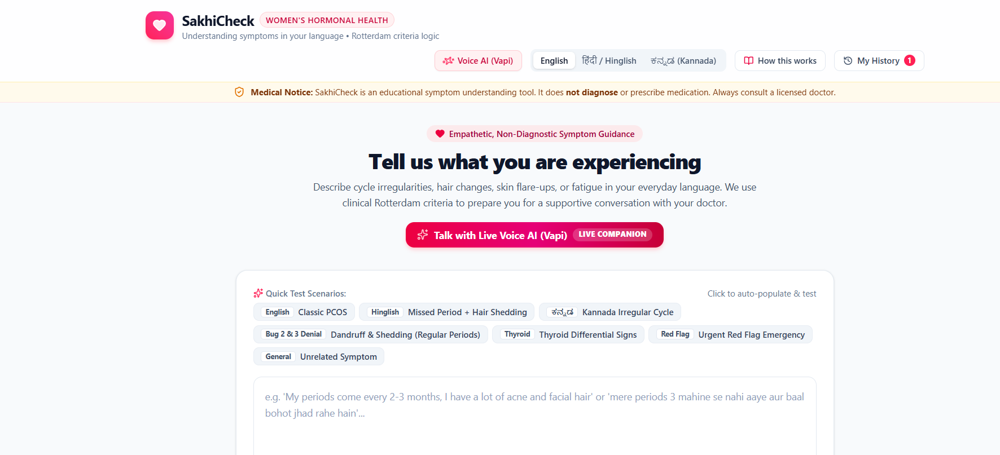
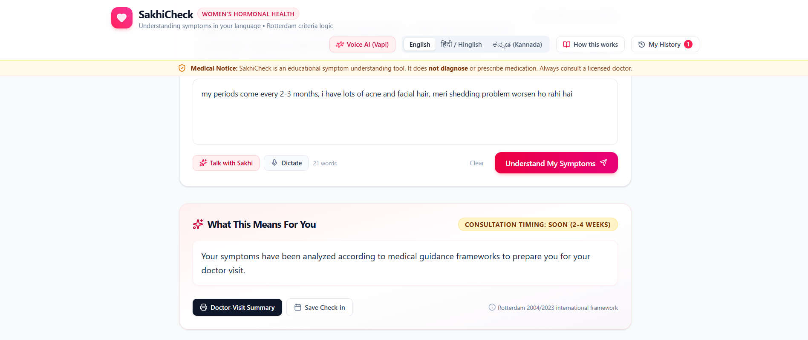
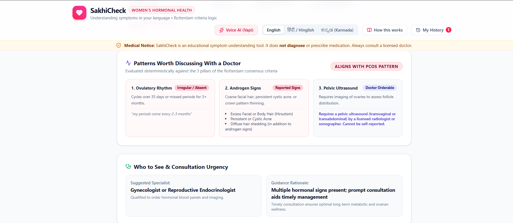

[README.md](https://github.com/user-attachments/files/33490924/README.md)
# SakhiCheck

A hackathon prototype that helps women describe symptoms in their own language and arrive at a doctor's visit better informed. Built for the problem statement **Women's Health: Understanding Symptoms**, with a focus on PCOS-related patterns.

> **SakhiCheck is educational information, not medical advice. It does not diagnose.** It never says "you have PCOS" and never gives a diagnosis, probability, or percentage.

## Screenshots

The screenshots below are included in this repository and displayed here on GitHub.

### Interface
The main screen before any input, showing the input options.

### Overview
A plain-language overview of the result, in the style of an AI overview.

### Advice
The information-extraction and understanding step: what the app picked up from the input and how it was interpreted, with suggestions on who to see and what to ask.

## What it does

A user describes symptoms in everyday language (English, Hindi, Kannada, or mixed Hinglish/Kanglish), typed or spoken. The app:

1. **Extracts** structured symptoms from the text using Gemini (JSON output mapped onto a fixed list of symptom keys)
2. **Matches** them against a local knowledge base using Rotterdam-style criteria logic (deterministic rules, not the LLM)
3. **Explains** the result in plain language
4. **Suggests** who to see, what tests a doctor may suggest, and questions to ask

## How it works

**Gemini understands, rules decide.** Gemini only maps messy input (typos, slang, romanized Hindi) onto predefined symptom keys. A deterministic matcher then applies the criteria logic to those keys. The LLM never decides which condition patterns apply.

- **Fuzzy fallback:** if the API fails or times out, the app falls back to Fuse.js fuzzy matching over the synonym lists.
- **Red-flag check:** runs on both the raw text (keywords) and the model output.
- **Data layer:** JSON files in `/data` shaped like MongoDB collections (`conditions`, `symptoms`, `care_pathways`, `red_flags`, `sessions`), accessed through a single module, `db.ts`.

## Safety rules

- Never diagnoses; uses wording like "can be associated with" and "worth discussing with a doctor"
- A visible disclaimer is always shown
- Red flags (severe pelvic pain, soaking a pad every hour, fainting, pregnancy with bleeding or pain, sudden severe symptoms, self-harm thoughts) show an urgent "seek medical care now" message first and skip the PCOS analysis
- No specific medicines or doses
- Unrelated symptoms get a polite note and a suggestion to see a general physician

## Tech stack

- Google AI Studio (Build mode), Gemini 3.8 Flash
- TypeScript, local JSON knowledge base, Fuse.js

## Current status

This is a time-boxed prototype (3 hours), so it is unfinished.

**Working**
- Knowledge base and `db.ts` data layer
- Deterministic matcher
- Basic input, extraction, and result display (see screenshots)
- Voice input, in an early form

**Known issues (being fixed one at a time)**
- Extraction does not yet reliably map every phrasing to symptom keys, especially romanized Hindi and short or fragmented voice transcripts
- Negations ("my periods are normal") are not always respected
- Hair shedding on its own is too nonspecific and should not trigger a PCOS match
- The "unrelated symptoms" message must stay generic and not name symptoms the user never mentioned

**Not done yet**
- Full output-card UI (editable symptom chips with evidence, doctor-visit summary)
- "How this works" panel
- Local history and trend card
- Express/MongoDB server folder

## A note on MongoDB

The data layer is MongoDB-document shaped so it can be swapped for MongoDB Atlas later. **The live app currently reads from local JSON files, not from MongoDB.**

## Running it

The app is built and run in Google AI Studio, where `GEMINI_API_KEY` is configured as a server-side secret. To run it elsewhere, set `GEMINI_API_KEY` in your environment. Never commit a real API key.

## Privacy

There is no login. Any history is meant to stay on the user's device, with a "clear my data" option.

## Disclaimer

SakhiCheck is a student hackathon prototype for educational purposes. It is not a medical device and cannot replace a qualified healthcare professional. If you have severe symptoms, seek medical care immediately.
